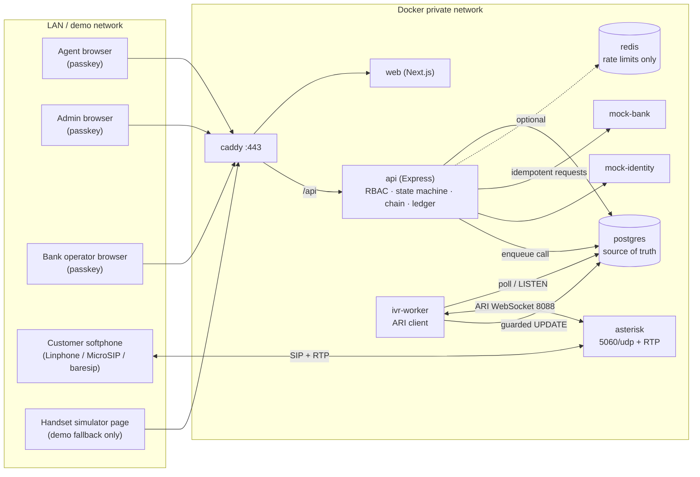
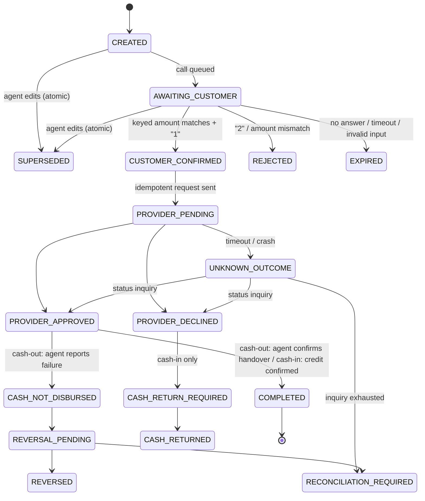
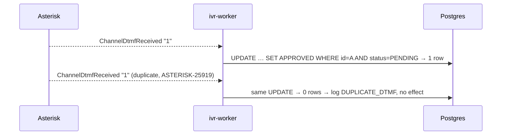
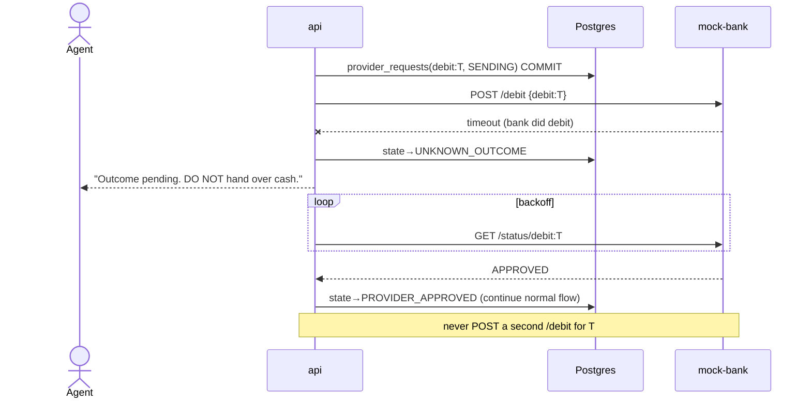

# BharatPoint: Architecture Audit

**Date:** 2026-10-14
**Scope:** feasibility, security, telephony, data model, cost, and implementation plan for BharatPoint, including a source-level audit of PRISM (`sarvan-2187/PRISM`, commit `680037b`, 2026-09-08).
**BharatPoint repo state:** empty (no commits). Everything about BharatPoint below is a **proposal**.

### Evidence labels

| Label | Meaning |
|---|---|
| **[VERIFIED]** | Read in PRISM source at the cited file and line, or executed during this audit |
| **[DOC-ONLY]** | Stated in PRISM docs or comments, not confirmed in code or at runtime |
| **[PROPOSED]** | Recommendation for BharatPoint; nothing exists yet |
| **[UNKNOWN]** | Not verifiable from here; needs investigation, legal advice, or a provider quote |

### What was actually done during this audit

- Cloned PRISM, read every backend security module, the migrations, the middleware, and the config, plus the frontend routes and the second (mobile) backend.
- `npm ci` and `tsc --noEmit` on `backend/`: **typecheck passed**.
- Ran the unit tests individually. **Passed:** `test:hash`, `test:canon2`, `test:challenge`, `test:risk`, `test:network`, `test:otp`.
- **Not executed:** `test:semantic`, `test:qr`, `test:chain`, `test:offline`, `test:bypass`, `test:e2e`. They need Postgres and Redis, and Docker Desktop was not running. They failed with `ECONNREFUSED`, not with assertion failures. Their correctness is **unverified**.
- Read official and primary sources on telephony and regulation. Links are in [Sources](#sources).

---

## 1. Executive verdict

**BharatPoint is feasible as a local, simulated prototype.** It is **not** feasible as a real banking or AePS deployment without a sponsor bank, licensed telephony, UIDAI-ecosystem access, and regulatory work, none of which software can substitute for.

The core idea is sound and worth building: an independent, customer-facing confirmation of the exact amount the agent entered. PRISM already contains the hardest part, done well: binding an approval to an immutable transaction record and making settlement depend on durable, MAC'd proof that every required check ran. Reuse that.

What needs redesign:

1. **Who confirms changes.** In PRISM the *payer* signs on their own device. In BharatPoint the *agent* holds the device, and the customer confirms over a phone channel that carries no cryptographic proof of who pressed the key. The PRISM model carries over to the **agent** (agent signs the intent with a passkey, for non-repudiation). The customer step is a **new** chain stage with weaker guarantees.
2. **Press 1 is the weakest version of the idea.** Have the customer **key in the amount** on the call (blind entry), then compare it server-side to the agent's amount. A habituated "press 1" defends poorly against an agent who inflates the amount and talks fast.
3. **The ledger must change shape.** PRISM's ledger moves money between user accounts and allows exactly two legs per transaction. BharatPoint must model the agent's **e-float** and **physical cash drawer**. The (mock) bank, not BharatPoint, must be the source of truth for customer balances.
4. **Roles do not exist in PRISM.** There is no admin, agent, or operator concept anywhere in the schema or the middleware [VERIFIED]. Role-based access control (RBAC) is new work.
5. **A free call to a real Indian mobile is not possible.** Self-hosted Asterisk can simulate the whole flow on local SIP softphones for free. Reaching a real handset requires a paid, licensed telephony provider. For a regulated entity, transactional and service calls must also come from the **1600-series** numbering under the RBI and TRAI directions.

**The smallest secure prototype:** one vertical slice of a **cash withdrawal** against a mock bank. Customer confirmation runs through a **browser-based handset simulator** first, then through **Asterisk ARI + a local softphone**. Every step is bound by an extended PRISM intent hash and attestation chain, with idempotent provider calls and an `UNKNOWN_OUTCOME` path that never hands over cash.

---

## 2. Feasibility by feature

| Feature | Local prototype | Real deployment | Notes |
|---|---|---|---|
| Agent / admin / bank-operator login with passkeys | ✅ High (reuse PRISM) | ✅ High | Needs RBAC, invite-only enrolment, recovery, server-side session revocation |
| Immutable transaction intent + approval binding | ✅ High (reuse PRISM) | ✅ High | Extend the hashed fields: type, account ref, bank, agent, customer |
| Customer confirmation over IVR (local SIP) | ✅ High | — | Asterisk ARI + softphone, all $0 |
| Customer confirmation call to a real mobile | ❌ Not free | ⚠️ Medium | Licensed provider; 1600-series for regulated entities; per-call cost [UNKNOWN] |
| Customer keys in the amount (blind entry) | ✅ High | ⚠️ Medium | Usability with low-literacy users must be field-tested |
| Multilingual voice prompts | ⚠️ Medium | ⚠️ Medium | Indian-language number reading (lakh/crore) needs custom prompt assets |
| Mock bank / provider with timeouts and unknown outcomes | ✅ High | n/a | Has to deliberately simulate failure modes |
| Real bank account lookup by mobile number | ❌ | ⚠️ Requires sponsor bank / provider | A mobile number is not a unique account key |
| Customer biometric (AePS-grade) | ❌ Simulated only | ⚠️ Requires AUA/KUA chain, L1 registered devices, sponsor bank | A webcam, WebAuthn, or local fake proves nothing about Aadhaar |
| DigiLocker document verification | ❌ Simulated only | ⚠️ Requires organization onboarding | Document verification ≠ biometric authentication |
| Double-entry ledger for float and cash | ✅ High | ✅ High | New schema; reuse PRISM's locking pattern |
| Reconciliation (physical cash vs e-float vs provider) | ✅ Medium | ⚠️ Medium | Real reconciliation consumes bank/NPCI settlement files [UNKNOWN format] |
| Admin dashboard (agents, limits, float, replenishment) | ✅ High | ✅ High | Ordinary CRUD + RBAC |
| Bank operations console | ✅ High (simulated bank view) | ⚠️ | In reality, the bank runs this. Clarify whose system it is (§6.4) |
| Continues working when Redis is down | ⚠️ Not with PRISM as-is | — | PRISM's rate limiter fails every request when Redis errors [VERIFIED] (§3, F-07) |
| Continues working when IVR is down | ✅ If designed | ✅ | Fail closed for money; fall back to the simulator only in demo mode |

---

## 3. Verified audit findings for PRISM

### 3.1 What PRISM is (VERIFIED)

- **Backend:** one Express + TypeScript monolith (`backend/src/index.ts`), `pg` directly (no ORM), `ioredis`, `@simplewebauthn/server` **9.0.3**. npm's current release is **14.0.3**, five major versions ahead.
- **Frontend:** Vite + React Router SPA (`frontend/src/App.tsx:216-238`) with shadcn/ui components. **It is not Next.js.** Every route is single-user: `/home`, `/pay`, `/pay/:txId/...`, `/receive`, `/scan`, `/offline`, `/settings`, `/attacks`.
- **Second backend:** `prism_expo_app/backend/` is a separate Express server on `:4100`. It shares the same Postgres and imports the web backend's modules (`prism_expo_app/backend/src/index.ts:16-21`).
- **Docker:** `docker-compose.yml` runs **only** Postgres 15 and Redis 7. Its header comment says there are deliberately no Dockerfiles (`docker-compose.yml:1-6`).
- **Tests:** standalone `ts-node` assertion scripts with no test framework, and there is no CI configuration (no `.github/`).

### 3.2 Strengths worth reusing (VERIFIED)

| # | Finding | Evidence |
|---|---|---|
| S-1 | Money stored as integer paise (`BIGINT`), with `CHECK (amount_minor > 0)` | `migrations/001_initial_schema.sql:4-6, 87` |
| S-2 | Intent is immutable and canonically hashed. The hash **is** the WebAuthn challenge, so a signature covers the exact transaction | `utils/canonical.ts:39-79`, `modules/identity/webauthn.ts:167-189` |
| S-3 | Changing an amount creates a new transaction (supersede), never an in-place edit | `routes.ts:874-910`, `intentLock.ts:203-209` |
| S-4 | Attestation chain: append-only, hash-linked, HMAC'd steps, with DB-enforced `UNIQUE (transaction_id, attempt, stage)` and stage ordering | `migrations/002_proof_carrying_authorization.sql:49-72`, `chain.ts:90-259` |
| S-5 | Settlement capability: MAC'd, expiring, and consumed **inside the same DB transaction** as the ledger write, under row locks taken in a deterministic order | `settlement.ts:56-175` |
| S-6 | Four independent replay barriers: Redis nonce, chain uniqueness, capability `consumed_at IS NULL`, ledger `UNIQUE (transaction_id, direction)` | `intentLock.ts:126`, `chain.ts:155-172`, `settlement.ts:109-114`, `001:123` |
| S-7 | User identity comes only from a signed httpOnly cookie, never from the request body | `middleware/session.ts:1-11, 51-67` |
| S-8 | Server-authoritative presentation: the client renders only what the server returns | `routes.ts:80-103` |
| S-9 | Purpose-separated keys derived by HKDF; constant-time MAC comparison | `keyManager.ts:48-59, 208-213` |
| S-10 | `markFailed` refuses to overwrite `SETTLED` | `intentLock.ts:194-200` |
| S-11 | A real attack-simulation harness (`attacks/01..10`). Its concept is directly reusable as BharatPoint's security test suite | `attacks/`, `backend/src/modules/attacks/` |

### 3.3 Defects and risks (VERIFIED unless labelled)

Severity is judged **for a BharatPoint deployment**, not for PRISM's hackathon demo.

| # | Sev | Finding | Evidence | Why it matters for BharatPoint |
|---|---|---|---|---|
| F-01 | **High** | **No roles or RBAC.** `users` has no role column, and the attack module says so in its own comment: "PRISM has no admin/cross-user role" | `001:29-34`; `modules/attacks/auth.ts:4-7` | Admin and bank consoles need cross-user reads. All authorization is new work |
| F-02 | **High** | **First-passkey bootstrap is unauthenticated.** Anyone who knows the email of an account with no passkey can enrol their own authenticator and get a session | `routes.ts:62-69, 119-129` | An agent account created by an admin could be claimed by whoever enrols first. BharatPoint needs **admin-issued, single-use, expiring enrolment invites** |
| F-03 | **High** | **`/auth/dev-login` issues a session for any email**, gated only by `NODE_ENV !== 'production'`, and `.env.example` defaults to `NODE_ENV=development` | `routes.ts:163-172`; `.env.example:5` | Any LAN deployment that forgets `NODE_ENV=production` is open. Delete it, or make it opt-in (`DEMO_LOGIN=1`) and bind it to loopback |
| F-04 | **High** | **Audit writes are best-effort and outside the money transaction.** Failures are swallowed. `PAYMENT_SETTLED` is written **after** `COMMIT` | `audit/logger.ts:62-70`; `settlement.ts:153-159` | A financial event with no audit row is possible. Financial events must be written in the same DB transaction as the state change |
| F-05 | Med | **Audit log immutability is "discipline, not a grant"**: no trigger, no restricted DB role | `001:128-141`; `logger.ts:7-10` | Add a `REVOKE UPDATE, DELETE` app role and a `BEFORE UPDATE OR DELETE` trigger that raises |
| F-06 | Med | **Sessions cannot be revoked.** Stateless HS256 JWT, 8 h TTL; logout only clears the cookie | `session.ts:17, 29-48`; `keyManager.ts:156-169` | A fired agent or a stolen laptop keeps access for up to 8 h. Needs a `sessions` table (or deny-list) checked on each request, plus shorter TTLs for privileged roles |
| F-07 | Med | **A Redis outage becomes a full API outage.** `express-rate-limit` 7.5.1 defaults `passOnStoreError: false`, PRISM does not override it, and the limiter wraps every `/api/v1` route | `rateLimiter.ts:14-27`; `routes.ts:35`; verified default in installed `express-rate-limit` 7.5.1 | Conflicts with the requirement that the app keeps working without Redis. Runtime behaviour not executed (no Docker) |
| F-08 | Med | **Nonce and challenge state live only in Redis.** A flushed or restarted Redis turns live intents into `INTENT_EXPIRED`. Challenge check-and-delete (`GET` then `DEL`) is not atomic | `intentLock.ts:126, 175-183`; `webauthn.ts:202-207` | Fails closed, which is safe, and DB barriers (S-6) still stop double settlement. Single-use state for **customer approvals** belongs in Postgres |
| F-09 | Med | **Amend is not atomic.** The new intent is locked, then the old one is superseded in a separate statement, with no row lock on the old transaction | `routes.ts:893-900` | In BharatPoint, "agent changes amount" is the core threat. Supersede must happen in one DB transaction with `SELECT … FOR UPDATE` on the old row |
| F-10 | Med | **`trust proxy = 1` with the API listening on all interfaces.** If a client reaches `:4000` directly instead of through the Vite proxy, it controls `X-Forwarded-For` and therefore its rate-limit identity. The code comment says this is "unspoofable", which holds only behind the proxy | `index.ts:20-30, 103` | Bind the API to the private Docker network only; terminate at Caddy |
| F-11 | Med | **Postgres and Redis are published on all host interfaces with default credentials**, and Redis has no password | `docker-compose.yml:14-18, 27-30` | Anyone on the LAN (demo venue Wi-Fi) can read and write the database. Do not publish them, or bind to `127.0.0.1` |
| F-12 | Med | **The schema is mutated outside migrations.** The mobile backend runs `ALTER TYPE … ADD VALUE 'DEVICE_APPROVED'` and adds a column at boot. `chain.ts` lists `DEVICE_APPROVED` in `STAGE_ORDER`, but no migration creates it | `prism_expo_app/backend/src/schema.ts:20-33`; `chain.ts:42` | Schema drift: the DB shape depends on which servers have started. Don't carry this pattern over |
| F-13 | Med | **The intent hash binds payer user and payee account, but not payer account, transaction type, or channel** | `canonical.ts:39-49` | BharatPoint must add `txnType`, `customerId`, `accountRef`, `bankId`, `agentId`, and `confirmationMode` to the hashed set |
| F-14 | Low | **Attack-operator token compared with `!==`** (not constant-time); it is a shared static secret | `modules/attacks/auth.ts:22-23` | Exclude the attack router from production builds entirely |
| F-15 | Low | **User enumeration:** login/register options return `NOT_FOUND` for unknown emails | `routes.ts:43-47, 131-138` | Minor for staff logins, but easy to fix |
| F-16 | Low | **Unauthenticated device poll.** `/authenticator/pending?deviceId=` returns a user's pending step-up details to anyone holding the id | `routes.ts:847-865` | Not needed in BharatPoint; drop it |
| F-17 | Low | **`backend/package.json` has a duplicate `"test"` key.** The last one wins, so `test:otp` is **not** part of `npm test` | `backend/package.json:12, 14` | Tests silently drop out of the suite |
| F-18 | Low | **Migration numbers collide** (two `002_`, two `003_`). The runner sorts by filename, so the order is deterministic but fragile | `migrate.ts:25`; `migrations/` | Use timestamps or strictly unique numbers |
| F-19 | Low | **Rate limits are at demo values** (3000 per 15 min default, 500 per 5 min strict). The comments say to restore production values (300 / 20) | `policy.ts:114-134`; `rateLimiter.ts:46-47` | Make these environment-configurable with safe defaults |
| F-20 | Info | **A 2.7 MB Windows binary is committed** (`.tools/mkcert.exe`) | repo tree | Supply-chain hygiene: download and verify it instead of committing it |
| F-21 | Info | **README contradicts the source.** It documents `docker-compose up --build` serving the frontend on `:3000`, but compose has no app services. It also says "Attack scripts ⛔ not started" while `attacks/01-10` exist | `README.md:792-800, 443`; `docker-compose.yml:1-6` | The README is not a reliable spec; trust the code |
| F-22 | Info | **The 90 s intent TTL** suits a browser approval but not an IVR call (ring + answer + prompt + entry routinely takes 30-90 s) | `policy.ts:11` | Use a separate confirmation TTL (about 3-5 min) |
| F-23 | Info | **Risk rules are tuned for P2P payments** (`NEW_PAYEE`, `HASTY_APPROVAL`, …) | `riskEngine.ts:34-86` | Keep the engine (pure, explainable); replace the rules with agent-banking signals |
| F-24 | [UNKNOWN] | Correctness of the DB-backed paths (`chain.test`, `settlement.bypass.test`, `offline.test`, `payment.e2e`) | Not executed | Run with Docker before relying on them |

### 3.4 Reuse decision per PRISM module

| PRISM module | Decision | Reason |
|---|---|---|
| `utils/canonical.ts` (intent hash) | **Reuse, extend** | Add BharatPoint fields (F-13). Keep the explicit field list and the integer checks |
| `modules/attestation/chain.ts` + migration 002 tables | **Reuse, extend stages** | New stages: `AGENT_SIGNED`, `CUSTOMER_CONFIRMED`, `LIMITS_CHECKED`, `RISK_APPROVED`, `PROVIDER_AUTHORIZED`, `CASH_HANDOVER_CONFIRMED`. Add them in a real migration (F-12) |
| `modules/ledger/settlement.ts` | **Reuse the pattern, replace the schema** | Keep: one DB transaction, ordered `FOR UPDATE`, capability consumption. Replace: two-leg `ledger_entries` and the mutable `balance_minor` |
| `modules/identity/webauthn.ts` | **Reuse for staff** | Fix the enrolment bootstrap (F-02). Upgrade `@simplewebauthn/server` deliberately (9 → current; API changes between majors [UNKNOWN effort]) |
| `modules/keys/keyManager.ts` | **Reuse** | Add keys for callback HMAC and receipts. Require `PRISM_ATTESTATION_ROOT` (renamed) in non-dev environments |
| `api/middleware/session.ts` | **Modify** | Add `role` and `sid` claims and a server-side session lookup (F-06) |
| `api/middleware/rateLimiter.ts` | **Modify** | `passOnStoreError: true` for general routes; keep fail-closed only where brute force is the threat (F-07) |
| `api/errors.ts` (failure catalogue) | **Reuse** | Extend with BharatPoint codes |
| `modules/audit/logger.ts` | **Modify** | Add a transactional variant that takes a `PoolClient`; enforce immutability in the DB (F-04, F-05) |
| `modules/risk/riskEngine.ts` | **Reuse the engine, replace the rules** | F-23 |
| `modules/policy/firewall.ts` + `authorizationPolicy.ts` | **Reuse the pattern** | Limits become data (the `transaction_limits` table), not code constants |
| `db/migrate.ts` | **Reuse** | Fix numbering (F-18) |
| `modules/identity/softAuthenticator.ts` | **Reuse in tests only** | Headless passkeys for E2E |
| `attacks/` harness | **Reuse the concept** | Rewrite the scenarios for BharatPoint threats (§9) |
| QR, offline grants (BLACKOUT), duress, semantic quiz, Authenticator OTP | **Drop** | No fit. Offline cash authorization is actively dangerous for agent banking |
| `prism_expo_app/backend` (second server) | **Drop** | One backend, one ledger |
| Frontend (Vite SPA) | **Low reuse** | Different screens and roles. shadcn components and `webauthn-client.ts` are portable |
| `/auth/dev-login`, attack routes, `/demo/my-session` | **Drop from production builds** | F-03, F-14 |

**Repository strategy [PROPOSED]:** copy the reused backend modules into `Bharat-Point/backend/`, record the source commit (`PRISM@680037b`) in a `NOTICE` or the commit message, and do **not** share PRISM's database. A shared package or submodule adds coupling between two products with different domain models for no current benefit.

---

## 4. Recommended target architecture [PROPOSED]

### 4.1 Principles

1. **One backend, one authoritative Postgres.** Redis is optional and never holds the only copy of anything that decides whether money moves.
2. **The bank (mock or real) owns customer balances.** BharatPoint owns transactions, authorizations, agent float, the agent cash drawer, and the audit trail.
3. **Every money-moving step is a guarded state transition** (`UPDATE … WHERE state = $expected`) inside a DB transaction that also writes its event and audit rows.
4. **Nothing reaches the backend's decision logic from the agent's browser except the agent's own intent.** Customer confirmation arrives only from the IVR worker over a private network.
5. **Fail closed for money, fail open for convenience** (rate limiting, caches).

### 4.2 Frontend choice

You've chosen Next.js. That works if it is a **UI shell**: route handlers stay out of business logic, and `/api/*` is proxied (rewrites, or Caddy) to the Express backend so cookies and the WebAuthn origin stay same-origin. Keeping Vite would be less work and reuses PRISM's WebAuthn client and components. For an authenticated dashboard, Next.js SSR buys little. Either way, **all authorization is enforced in Express middleware**, never by hiding routes.

### 4.3 Containers and network

| Container | Image | Exposed to LAN | Private ports | Notes |
|---|---|---|---|---|
| `caddy` | caddy | **443/tcp** | — | TLS (mkcert locally), routes `/` → web, `/api` → api |
| `web` | Next.js (own Dockerfile) | no | 3000 | UI only |
| `api` | Node/Express (own Dockerfile) | no | 4000 | Business logic, RBAC, state machine |
| `ivr-worker` | Node (same codebase as `api`, different entrypoint) | no | — | ARI WebSocket client to Asterisk; writes confirmations straight to Postgres |
| `asterisk` | Asterisk 22 LTS (own Dockerfile; no official image found) | **5060/udp + small RTP range (for example 10000-10049/udp), LAN only** | 8088 (ARI, private) | Softphones register here. ARI is never published |
| `mock-bank` | Node (tiny) | no | 4100 | Simulates accounts, holds, debits, timeouts, unknown outcomes, status inquiry |
| `mock-identity` | Node (tiny) or folded into `mock-bank` | no | 4200 | Returns `SIMULATED` verification results |
| `postgres` | postgres:16 | **no** (or `127.0.0.1` only for dev tools) | 5432 | Separate roles: `bp_migrator`, `bp_app` (no `UPDATE`/`DELETE` on audit and event tables) |
| `redis` | redis:7 | **no** | 6379 | Password set; rate limiting only |

**Secrets:** an `.env` file that is never committed, plus `.env.example` with no values. Compose `secrets:` for the DB password, the attestation root, and the ARI password. A fresh random SIP password per demo softphone. In production: a secrets manager or HSM [UNKNOWN provider].

**Windows / Docker Desktop caveat:** SIP media (RTP over UDP) through Docker Desktop's NAT is the most common reason local VoIP setups fail. Keep the RTP range small, set `external_media_address` / `external_signaling_address` / `local_net` in `pjsip.conf`, and for automated tests run a CLI softphone (e.g., baresip) **inside** the Docker network so no host NAT is involved.

### 4.4 Architecture diagram



The IVR worker takes call jobs from Postgres (`SELECT … FOR UPDATE SKIP LOCKED`, or `LISTEN/NOTIFY`) and writes outcomes back with guarded updates. **No HTTP callback endpoint is exposed at all**, which removes forged-callback attacks in the local architecture. When a hosted provider is added later (Architecture B), its webhook terminates at a dedicated, signature-verified endpoint (§11).

---

## 5. Core innovation: customer-controlled authorization

### 5.1 What to call it

| Term | Accurate? | Why |
|---|---|---|
| Two-factor authentication | **No, not on its own** | A keypress on an answered call proves, at best, possession of whatever handset answered the registered number. That is one weak possession signal (SIM swap, shared phones, an agent holding the phone). There is no knowledge or inherence factor |
| Transaction signing | **No** | No cryptographic signature from a customer-held key |
| **Out-of-band transaction confirmation** | **Yes** | A separate channel, outside the agent's control, used to confirm the transaction details |
| **Transaction authorization (customer consent)** | **Yes** | It is a consent gate bound to exact details |

In a real AePS flow, the bank or provider's biometric authentication is the **authentication**. BharatPoint's call is an **additional, amount-bound confirmation control** that targets a specific fraud: the customer authenticates, but never sees the amount the agent keyed. Note that the RBI's 2025 authentication directions (effective 2026-04-01) require at least two factors, one dynamic, for digital payments [secondary sources]. Whether and how an IVR confirmation counts toward that is a **legal question** [UNKNOWN].

### 5.2 Recommended confirmation design

**Recommendation: blind amount entry on the call, plus read-back.**

1. The customer **tells the agent** the amount, verbally. The customer cannot independently type into the agent's device, so forcing "customer enters it first on the agent's screen" adds nothing: the agent controls that screen.
2. The agent enters the amount. The backend creates the immutable transaction.
3. The call says: *"BharatPoint. A cash withdrawal has been started for you at agent «Ramesh, Kothapalli». Please type the amount you asked for, then press hash."* **The amount is not spoken first.**
4. The customer keys `200#`.
5. The backend compares it to the agent's ₹200:
   - **Match:** read back *"You entered two hundred rupees, withdrawal. Press 1 to approve, 2 to cancel."* Approval requires `1`.
   - **Mismatch:** *"This does not match the amount entered by the agent. The transaction is cancelled."* The transaction moves to `REJECTED_AMOUNT_MISMATCH`, an agent risk event is raised, and the mismatch count shows in the admin dashboard.
6. **Accessibility fallback** (configurable per customer): read-back only, "Press 1 to approve ₹200". Mark the authorization `mode = READBACK`, record it on the chain, and apply lower limits.

**Why:** "press 1" degrades to a reflex, and an agent can say "just press 1, it's the confirmation". With blind entry the customer has to produce the number, so a mismatch is caught even if the customer doesn't listen carefully. The whole-rupee format also defeats paise-level tricks: no decimals on the keypad, and amounts at agent points are typically whole rupees.

**Discrepancy detection (backend):**
`customer_keyed_minor` is stored on the `transaction_authorizations` row. Mismatch is a **terminal** outcome for that transaction, never "let the agent fix it". A corrected amount means a new transaction and a new call. Repeated mismatches per agent feed risk scoring and automatic agent suspension thresholds (data-driven limits).

### 5.3 Binding rules (how each critical condition is enforced)

The authorization record carries `binding_hash = canonicalHash({txId, txnType, amountMinor, customerId, accountRef, bankId, agentId, intentHash, authId, nonce, expiresAt})`. The IVR worker loads the transaction by `authId`, recomputes the hash from the **transaction row**, and refuses on mismatch.

| Condition | Enforcement |
|---|---|
| Agent changes ₹200 → ₹500 after approval | Transactions are immutable (hashed fields never UPDATEd; enforce with a trigger). "Change" = `supersede`: in **one DB transaction**, `SELECT … FOR UPDATE` the old row, require state ∈ {CREATED, AWAITING_CUSTOMER}, set `SUPERSEDED`, create a new transaction. An old approval cannot settle: the capability names the old `txId` and intent hash, and settlement re-verifies against the row (PRISM S-5) |
| Approval bound to exact amount, type, account, bank, customer, expiry | All of these are in `intent_hash` and `binding_hash`; settlement verifies both |
| No answer / unanswered / invalid key / rejection / expiry ≠ approval | Approval is **only** set by `UPDATE transaction_authorizations SET status='APPROVED' … WHERE id=$1 AND status='PENDING' AND expires_at > now() AND keyed_match = true AND key='1'`. Every other path writes a terminal non-approved status. The capability mint requires `status='APPROVED'` |
| Duplicate IVR callback | The guarded UPDATE above affects 0 rows the second time. `UNIQUE (authorization_id)` on the decision. Asterisk's ARI has a documented duplicate-DTMF bug (ASTERISK-25919), so this is real, not hypothetical |
| Agent's browser cannot mark it approved | No API route sets authorization status. Only the `ivr-worker` DB role may update `transaction_authorizations.status` (column-level `GRANT UPDATE (status, …)` to `bp_ivr` only) |
| Customer approves another customer's transaction | The call is placed to the phone on file for the **transaction's** `customer_id`, and the DTMF arrives on a channel that maps 1:1 to one `call_attempt` → one `authorization` → one transaction. There is no customer-supplied transaction ID to tamper with |
| Old approval authorizes a new transaction | `authId` and the nonce are single-use. The capability is bound to `txId` + `intent_hash` + chain tip |
| Cash-in approval used for cash-out | `txnType` is in both hashes, and the prompt states the type |
| Failed or uncertain bank response → no blind retry | Provider requests are idempotent (the transaction id is the idempotency key). Timeout → `UNKNOWN_OUTCOME` → **status inquiry only**; a new debit is never sent (§7) |
| Customer changes their mind on the amount | The customer cancels (presses 2, or mismatch) → terminal. The agent starts a new transaction → new call |

### 5.4 Risks the call alone cannot solve

- **The agent holds the customer's phone.** This is common in assisted rural settings. The agent can key the inflated amount and press 1. No IVR design fixes this. Partial mitigations: a post-transaction SMS or voice notification from the **bank**, receipts that show the amount, agent risk scoring on complaint rates, low per-transaction limits, and customer education ("never give your phone to the agent").
- **SIM swap, phone theft, shared family phones.** The call goes to whoever holds the SIM.
- **Coercion or social engineering** of the customer, which is out of scope for any confirmation step.
- **No coverage at the agent point.** The call fails. Policy decision: fail closed (no transaction) vs. a lower-limit fallback. Recommendation: fail closed in the prototype.
- **Customer identity.** The call proves nothing about *which account* is debited. That comes from bank/provider authentication (biometric in AePS).
- **Physical cash fraud** (short-changing after a correct electronic transaction). Mitigations: receipts + an amount-bound confirmation call + complaints.

---

## 6. Identity, biometrics, DigiLocker, and banking integration

### 6.1 WebAuthn for staff (agent, admin, bank operator)

**Use it [PROPOSED, reuse PRISM].** Constraints:
- **Secure context and RP ID:** HTTPS (or literal `localhost`). The RP ID must be a registrable domain, not an IP. Pick the final hostname (e.g., `bharatpoint.local` for the LAN, a real domain later) **before** anyone enrols, because changing the RP ID invalidates every passkey (PRISM documents this: `.env.example:12-15`).
- **The app never receives fingerprint or face data.** The OS unlocks a private key; the server receives a signature.
- **Recovery and device change:** need an admin-mediated re-enrolment flow (revoke old credentials → issue a new single-use invite). Synced passkeys (`backed_up = true`) survive a device change but widen the trust boundary to the user's cloud account. Policy decision: allow them for admins? [UNKNOWN; business decision].
- **Shared agent devices:** agents in the field may share a tablet. Each agent needs their own credential. Use roaming authenticators (security keys) if devices are shared.
- **Agent signs the intent:** reuse PRISM's "challenge = intent hash" for the agent. That gives strong non-repudiation that *this agent* entered *this amount*, which is valuable in disputes.

### 6.2 Customer biometric verification

| | Simulated (local) | Genuine AePS |
|---|---|---|
| What happens | `mock-identity` returns `{result: "MATCH", mode: "SIMULATED"}` after a button press | The bank/provider sends PID data, captured on a **UIDAI registered device** and encrypted on-device, through an AUA/KUA chain to UIDAI. The bank authorizes the debit via NPCI AePS |
| Proves | Nothing | Aadhaar biometric match for the account holder, per the bank's authorization |
| Needs | Nothing | Sponsor bank / AePS provider agreement; registered devices (UIDAI is moving fingerprint devices from L0 to L1, with TEE on-device encryption; current deadline [UNKNOWN]); UIDAI ecosystem compliance |

Every simulated step must be labelled `SIMULATED` in the database (`identity_verifications.mode`), on the chain payload, on receipts, and in the UI. **Never** present a webcam capture, a WebAuthn assertion, or a locally generated "match" as Aadhaar or AePS authentication.

### 6.3 DigiLocker

- **What it provides:** consent-based (OAuth with PKCE) retrieval of documents issued into a user's DigiLocker. Requester organizations onboard through the API Setu partner portal using an official email domain, with NeGD verification and scope-based approval [official terms and FAQ].
- **What it does not provide:** biometric authentication, bank account discovery, or per-transaction authorization.
- **Fit for BharatPoint:** at most, one-time customer **onboarding / KYC document verification** by the bank or BC. Not part of the transaction path. Individual developers should not assume they can get production access [UNKNOWN eligibility and cost].
- **Prototype:** omit, or mock as `document_verification: SIMULATED`.

### 6.4 Customer identity and bank selection

- A mobile number can map to several banks and several accounts. **Never treat it as an account key.**
- **Real flow (requires provider):** the provider or sponsor bank returns the accounts linked to the customer's authenticated identity, as **opaque tokens + masked labels** (`SBI ••••4321`). BharatPoint stores only the token and the mask, never the full account number.
- **Demo:** `mock-bank` holds synthetic SBI-like and HDFC-like banks with names prefixed "Demo …" (e.g., "Demo State Bank"). Real bank names and logos in the UI risk looking like impersonation.
- **The bank operations console is the bank's view.** In reality a bank runs it inside its own perimeter. In the prototype it is a role (`BANK_OPERATOR`) scoped to **one `bank_id`**, so a Demo-SBI operator never sees Demo-HDFC transactions. It sees masked customer data only.
- **Regulatory flag:** RBI's BC circulars (2010-2012) state that a BC outlet represents **one bank** at the customer interface, with conditional interoperability allowed later. A multi-bank agent dashboard must be checked against the **current** RBI BC directions [UNKNOWN; these search results did not confirm which circulars are still in force].

### 6.5 Regulatory areas needing professional verification (not legal advice)

| Area | Why it applies | Status |
|---|---|---|
| RBI Business Correspondent framework | Agent cash-in/out is BC activity; the bank remains responsible for its BCs | Current consolidated directions [UNKNOWN] |
| RBI Authentication Mechanisms for Digital Payment Transactions Directions, 2025 (effective 2026-04-01) | Two-factor rule, risk-based checks, issuer liability | Read the primary RBI text |
| NPCI AePS operating guidelines | Interoperable biometric cash-out | Requires member bank access [UNKNOWN] |
| Aadhaar Act and UIDAI authentication regulations; registered devices | Biometrics | Requires AUA/KUA and sponsor arrangements |
| RBI circular (2025-01-17) + TRAI direction (2025-11-19) | Service and transactional calls by regulated entities only from **1600xx**; phased deadlines Jan-Mar 2026 | Applies to the bank's or RE's calls. Who "owns" BharatPoint's call matters [legal] |
| TRAI TCCCPR (commercial communications) | Voice calls to customers | [legal] |
| Digital Personal Data Protection Act, 2023 and the DPDP Rules | Phone numbers, identity data, consent, retention | [legal] |
| RBI IT governance and cyber-security directions for REs and their outsourced providers | Hosting, audit, incident reporting | [legal] |
| KYC Master Direction record retention | Retention periods | [legal] |

---

## 7. Transaction lifecycle and financial integrity

### 7.1 State machine



**Settlement is a separate dimension.** `COMPLETED` means the customer-facing transaction finished. **Interbank settlement** (provider → agent float) happens later in batches and is tracked as `settlement_status ∈ {UNSETTLED, SETTLED, DISPUTED}` with its own ledger postings. Collapsing both into "SETTLED", as in the proposed `… → SETTLED`, hides the most common reconciliation break.

### 7.2 Ordering

**Cash-out (withdrawal):**
customer identified → bank/account chosen → agent enters amount + signs with passkey → **customer confirms (IVR)** → limits/risk → capability minted → **provider debit** → provider approved → **agent hands over cash** → agent confirms handover → `COMPLETED` → receipt.
Cash leaves the drawer **only after** `PROVIDER_APPROVED`. The UI does not show "Hand over ₹200" until then.

**Cash-in (deposit):**
agent **receives and counts cash first** (the customer sees it counted) → agent enters amount + signs → **customer confirms (IVR, blind entry)** → provider credit → `COMPLETED` → receipt.
If the credit is declined: `CASH_RETURN_REQUIRED`, and the agent returns the cash. Optionally, a second short call confirms the return.

**Why customer confirmation comes before the provider:** it is the cheapest gate, it is fully reversible (nothing has moved), and it ensures the provider is never asked to move an amount the customer didn't confirm.

### 7.3 Failure handling

| Event | Handling |
|---|---|
| Call timeout / no answer | `EXPIRED`. Optional single redial within the authorization TTL (configurable, default 1). The same `authId` is reused, so approval still happens at most once |
| Bank timeout | `UNKNOWN_OUTCOME`. Run status inquiry with backoff (e.g., 5 s, 15 s, 60 s, 5 min). **No new debit.** Agent UI: "Do not hand over cash. Outcome pending." |
| Process crash mid-flow | Every step is a persisted state; a **recovery sweeper** on boot and periodically resumes `PROVIDER_PENDING` / `UNKNOWN_OUTCOME` via inquiry and expires stale `AWAITING_CUSTOMER` |
| Duplicate request from the agent UI | Client-generated `Idempotency-Key` header → `idempotency_keys` table (`UNIQUE (agent_id, key)`, stored response) |
| Callback replay | Guarded UPDATEs (0 rows → no-op) + `UNIQUE` on decisions |
| Cash-dispensing failure after debit | Agent reports `CASH_NOT_DISBURSED` (passkey-signed) → `REVERSAL_PENDING` → idempotent provider reversal (keyed `reversal:<txId>`) → `REVERSED`. **A DB rollback cannot undo a debit, and it cannot recall cash already handed over.** Corrections are new postings, never edits |
| Provider says approved after BharatPoint marked it failed | Handled by reconciliation against provider records: raise `RECONCILIATION_REQUIRED`, never silently overwrite |

### 7.4 Idempotency strategy

1. **Inbound (agent → API):** `Idempotency-Key` per create/confirm request, stored with the response hash. Replays return the stored response.
2. **Outbound (API → provider):** the provider request id is deterministic (`debit:<txId>`, `reversal:<txId>`). `provider_requests UNIQUE (transaction_id, kind)`. Before sending, insert the row in state `SENDING` in its own committed transaction. After a crash, a row in `SENDING` means "maybe sent" → inquiry, never resend blindly. Re-send the **same** id only if the provider contract guarantees idempotency on it [mock: yes; real: UNKNOWN until the provider contract is read].
3. **State transitions:** every transition is `UPDATE … WHERE id=$1 AND state=$expected RETURNING *`. Zero rows means someone else won the race.
4. **Money:** capability consumption + the ledger journal's `UNIQUE (transaction_id, purpose)` (PRISM S-5/S-6 pattern).

### 7.5 Ledger

**A double-entry ledger is required**, not for customer balances (the bank owns those) but to reconcile **agent e-float**, **agent physical cash**, **provider clearing**, and **commissions**.

Structure: `ledger_journals (id, transaction_id, purpose, created_at)` + `ledger_postings (journal_id, ledger_account_id, amount_minor signed)`, with a **deferred constraint trigger** asserting `SUM(amount_minor) = 0` per journal, and `UNIQUE (transaction_id, purpose)` on journals. Postings are append-only (trigger rejects UPDATE/DELETE). Balances are derived (`SUM`), optionally cached in a snapshot table that reconciliation re-derives.

| Event | Postings (amounts in paise) |
|---|---|
| Cash-out ₹200 approved by provider | Dr `provider_receivable` 20000 / Cr `agent_float_pending` 20000 *(depending on the provider model; confirm with the real provider)* |
| Cash handed over | Dr `agent_float_pending` 20000 / Cr `agent_cash_drawer` 20000 |
| Cash-in ₹500 credited | Dr `agent_cash_drawer` 50000 / Cr `agent_float` 50000 |
| Reversal | Mirror journal with `purpose = 'REVERSAL'`, linked to the original |
| Batch settlement | Dr `agent_float` / Cr `provider_receivable` |

**Physical cash vs e-float:** cash is a physical asset counted by the agent. The `agent_cash_drawer` ledger account is the *expected* count. Reconciliation compares it to the agent's declared end-of-day count (a `cash_counts` row, signed by the agent) and raises a variance alert. E-float is a claim on the bank and is reconciled against provider statements.

---

## 8. Database design review [PROPOSED]

Conventions: UUID PKs, `timestamptz`, money as `BIGINT` paise with `CHECK (> 0)` where it applies, `is_synthetic BOOLEAN NOT NULL DEFAULT true` on customer-facing data in the prototype, and a DB `CHECK` / app guard that refuses non-SIP destinations while `DEMO_MODE` is on.

| Entity | Keep? | Purpose / key fields | Constraints and indexes |
|---|---|---|---|
| `users` | Keep | Staff only: `email`, `display_name`, `role` (`AGENT`/`ADMIN`/`BANK_OPERATOR`), `bank_id` (for operators), `status` | `CHECK (role <> 'BANK_OPERATOR' OR bank_id IS NOT NULL)`. **Merge `user_roles` into `users.role`** unless someone genuinely holds several roles (YAGNI) |
| `user_roles` | **Drop** (see above) | — | — |
| `enrolment_invites` | **Add** | Single-use, expiring passkey enrolment token (fixes F-02): `token_hash`, `user_id`, `expires_at`, `used_at` | `UNIQUE (token_hash)` |
| `device_credentials` | Keep (PRISM `credentials`) | WebAuthn public keys, `revoked_at` | Index `user_id` |
| `sessions` | **Keep, needed** | Revocable sessions: `id` (in the JWT `sid`), `user_id`, `expires_at`, `revoked_at`, `ip`, `user_agent` | Index `(user_id) WHERE revoked_at IS NULL` |
| `agents` | Keep | `user_id`, `code`, `status` (`ACTIVE`/`SUSPENDED`), location fields inline | **Merge `locations` into `agents`** unless agents operate at several sites |
| `locations` | **Drop** (see above) | — | — |
| `customers` | Keep | `display_name`, `phone_e164_enc`, `phone_hash` (lookup), `preferred_language`, `confirmation_mode` (`BLIND_ENTRY`/`READBACK`), `is_synthetic`. **No Aadhaar number, ever** | `UNIQUE (phone_hash)` is **wrong**: shared family phones exist. Index it instead |
| `banks` | Keep | `code`, `display_name` ("Demo …"), `is_synthetic` | — |
| `accounts` → rename `customer_account_links` | Keep | `customer_id`, `bank_id`, `provider_token`, `masked_label`. **Not a balance holder** | `UNIQUE (bank_id, provider_token)` |
| `identity_verifications` | Keep | `customer_id`, `transaction_id`, `method` (`AEPS_BIOMETRIC`/`DOCUMENT`/…), `mode` (`SIMULATED`/`LIVE`), `result`, `provider_ref` | Separate from staff authentication (`device_credentials`) |
| `transactions` | Keep | `txn_type` (`CASH_IN`/`CASH_OUT`), `agent_id`, `customer_id`, `account_link_id`, `bank_id`, `amount_minor`, `intent_hash`, `nonce`, `state`, `settlement_status`, `superseded_by`, `created_at` | Trigger rejects UPDATE of hashed columns; `UNIQUE (intent_hash)`; index `(agent_id, created_at DESC)`, `(bank_id, state)`, partial index on non-terminal states for the recovery sweeper |
| `transaction_authorizations` | Keep | Customer confirmation: `transaction_id`, `channel` (`IVR`/`SIMULATOR`), `mode`, `binding_hash`, `status` (`PENDING`/`APPROVED`/`REJECTED`/`MISMATCH`/`EXPIRED`/`NO_ANSWER`/`INVALID_INPUT`), `customer_keyed_minor`, `decided_at`, `expires_at` | `UNIQUE (transaction_id) WHERE status='APPROVED'`; column-level `GRANT UPDATE` to the IVR role only |
| `call_attempts` | **Add** | `authorization_id`, `channel_id` (Asterisk), `dial_status`, `dtmf_log` (digits, no other audio), `started_at`, `ended_at` | `UNIQUE (channel_id)` |
| `authorization_steps`, `settlement_capabilities` | **Add (from PRISM)** | Attestation chain and capability | As PRISM migration 002, with BharatPoint stages |
| `provider_requests` | **Add** | `transaction_id`, `kind` (`DEBIT`/`CREDIT`/`REVERSAL`/`INQUIRY`), `request_id`, `state` (`SENDING`/`SENT`/`APPROVED`/`DECLINED`/`UNKNOWN`), `response`, timestamps | `UNIQUE (transaction_id, kind)` (inquiries may be many: separate table or exclude them from the constraint) |
| `idempotency_keys` | **Add** | `actor_id`, `key`, `request_hash`, `response`, `expires_at` | `UNIQUE (actor_id, key)` |
| `ledger_accounts` | Keep | `code`, `owner_type` (`AGENT`/`PROVIDER`/`PLATFORM`), `owner_id`, `kind` | `UNIQUE (owner_type, owner_id, kind)` |
| `ledger_entries` → `ledger_journals` + `ledger_postings` | Replace | §7.5 | Sum-zero deferred trigger; append-only trigger |
| `agent_cash_balances` | **Drop as a table**: derive from postings | A mutable balance table is a second source of truth. Add a snapshot only if `SUM` gets slow | — |
| `cash_counts` | **Add** | Agent's declared physical count, signed | Feeds reconciliation |
| `replenishment_requests` | Keep | `agent_id`, `kind` (`CASH`/`FLOAT`), `amount_minor`, `state`, `approved_by` | State-guarded transitions |
| `transaction_limits` | Keep | `scope` (`GLOBAL`/`AGENT`/`CUSTOMER`), `scope_id`, `txn_type`, `per_txn_max`, `daily_max`, `daily_count_max`, `effective_from` | Checked inside the capability-mint transaction |
| `risk_alerts` | **Add** | `kind` (`AMOUNT_MISMATCH`, `VELOCITY`, `CASH_VARIANCE`, …), `subject`, `state` | Drives the admin dashboard |
| `reconciliation_runs` / `reconciliation_items` | **Add** | Provider-statement vs ledger diffs | — |
| `transaction_events` | Keep | State transitions (business record), written in the same DB transaction as the transition | Append-only trigger |
| `audit_logs` | Keep | Security and access events (logins, console views, admin changes) | Append-only trigger; app role has no UPDATE/DELETE |

**Why both `transaction_events` and `audit_logs`:** events are the financial state history (needed to reconstruct a transaction). Audit logs record *who looked at or changed what*, including reads by bank operators. Different retention, different consumers.

**Transaction boundaries:** (1) create transaction + chain root + event; (2) each guarded state transition + event + audit; (3) capability mint + limits check; (4) capability consume + journal + state change + event. Provider HTTP calls happen **between** DB transactions, never inside one.

**Data minimization:** encrypt phone numbers at rest (app-level, key from keyManager); keep `phone_hash` (HMAC) for lookup; store masked account labels only; store DTMF digits but **no call audio**; retention periods [legal, §6.5].

---

## 9. Security threat model

Severity is impact if exploited; likelihood is for a field deployment.

| Threat | Sev | Likely | Impact | Mitigation | Residual |
|---|---|---|---|---|---|
| Agent enters wrong or inflated amount | High | High | Customer loses money | Blind-entry confirmation; mismatch → terminal + alert; agent passkey signature | Agent holds the customer's phone |
| Agent modifies after approval | High | Med | Unauthorized debit | Immutable hashed fields (trigger); atomic supersede; capability bound to intent hash | Low |
| Someone else answers the customer's phone | Med | Med | Unauthorized consent | Blind entry (requires knowing the amount); bank notification; limits | Accomplice standing beside the agent |
| SIM swap / theft / shared phone | High | Med | Consent from the wrong person | Bank-side authentication remains the real control; phone-change cooling-off period in customer records; limits | Not solvable by IVR |
| Replayed IVR response | High | Low | Double approval | Single-use `authId`; guarded UPDATE; channel ↔ attempt 1:1 | Low |
| Forged callback | High | Low (local) / Med (hosted) | Fake approval | Local: no callback endpoint; IVR worker on the private network with its own DB role. Hosted: provider signature verification + IP allow-list + replay window | Provider credential compromise |
| Duplicate transactions | High | Med | Double debit | Idempotency keys; provider request ids; ledger `UNIQUE` | Low |
| Customer/account mismatch | High | Med | Wrong account debited | Account comes from a provider token tied to the authenticated customer; the prompt names the bank | Agent selects a different linked account of the same customer → name the bank in the prompt |
| Agent privilege escalation | High | Med | Admin actions | Server-side RBAC on every route; role comes from the DB on each request (not just the JWT); tests per route | Low |
| Unauthorized bank-console access | High | Med | Data exposure | `BANK_OPERATOR` scoped to `bank_id` in every query; audit log of reads | Insider at the bank |
| Brute force / DoS | Med | Med | Lockout, cost | Rate limits (fail-open on Redis errors); per-customer call caps (a single customer can't be call-bombed: max N calls/hour); per-agent transaction velocity | Determined DoS on a LAN |
| Exposed SIP credentials / public SIP ports | High | High if exposed | Toll fraud once a trunk exists | Never publish 5060 to the internet; strong per-device passwords; ACLs (`permit`/`deny`); fail2ban; with a real trunk: an outbound route allow-list of **only** the bank-call pattern | Low if never public |
| Database compromise | Critical | Low | Everything | No published ports; least-privilege roles; encrypted PII; chain MACs reveal tampering (but don't prevent reads) | High impact, by nature |
| Leaked API credentials | High | Med | Provider abuse | Secrets out of git (fix the `.env` discipline); rotation; per-environment keys | Low-Med |
| Redis treated as financial truth | High | — | Lost approvals / double use | Approvals and nonces in Postgres; Redis only for rate limits | Low |
| Network loss mid-transaction | High | High (rural) | Unknown state | Persisted states; recovery sweeper; agent UI blocks cash handover until a definitive state | Customer waiting |
| Provider succeeds while local times out | Critical | Med | Customer debited, no cash or double cash | `UNKNOWN_OUTCOME` + inquiry; no re-debit; reconciliation | Delay for the customer |
| Cash handed over despite failed/incomplete txn | Critical | Med | Agent loss | UI gates; handover only after `PROVIDER_APPROVED`; agent attests handover; cash-count variance alerts | Agent ignores the UI (training, liability) |

**Not solved by press 1 / press 2:** the agent holding the phone, SIM swap, coercion, which account is debited, physical cash short-changing, provider-side failures, and every infrastructure threat above.

---

## 10. Interface and workflow requirements [PROPOSED]

All routes are under `/api/v1`. Every route declares its allowed roles in middleware (`requireRole('AGENT')`). Every mutating route takes `Idempotency-Key`.

### 10.1 Agent ATM dashboard

| Step | Screen shows | Actions | API | Validation | Failure states |
|---|---|---|---|---|---|
| Login | Passkey prompt | Sign in | `POST /auth/login/options`, `/auth/login/verify` | Role = AGENT, agent `ACTIVE` | Suspended, credential revoked |
| Customer identification + consent | Phone/customer search, consent checkbox read aloud | Find, record consent | `GET /customers?phone=` (returns 0..n, masked), `POST /transactions/draft` | Consent required; shows synthetic badge in demo | Not found → onboarding out of scope |
| Cash-in / cash-out | Two big buttons | Choose | (client state) | — | — |
| Bank/account | Masked list from provider | Select | `GET /customers/:id/accounts` | Account link belongs to the customer | Provider unavailable |
| (Simulated) biometric | "SIMULATED" banner | Run mock verification | `POST /transactions/:id/identity` | `mode = SIMULATED` recorded | Mismatch → stop |
| Amount entry | Keypad, whole rupees, limit hints | Enter, sign with passkey | `POST /transactions` (`challenge`) + `POST /transactions/:id/sign` | Integer > 0, ≤ limits; WebAuthn over the intent hash | Limit exceeded; float/cash insufficient (cash-out: agent cash drawer ≥ amount) |
| Customer call | "Calling customer…", live status (ringing, answered, waiting for input), countdown | Cancel | `GET /transactions/:id` (poll or SSE) | — | No answer, rejected, mismatch, expired |
| Authorization result | Clear outcome + reason code | Next / start over | — | — | — |
| Provider processing | "Processing with Demo Bank…" | — | (server-driven) | — | Declined; **UNKNOWN: "Do NOT hand over cash"** |
| Cash handling | Cash-out: "Hand over ₹200". Cash-in: "Cash received ₹500" (pre-confirmed) | Confirm handover / report failure (passkey) | `POST /transactions/:id/handover` or `/handover-failed` | State = `PROVIDER_APPROVED` | — |
| Receipt | Printable receipt with txn id, masked account, amount, mode labels (SIMULATED), verification code | Print/share | `GET /transactions/:id/receipt` (Ed25519-signed, reuse PRISM receipt key) | — | — |
| Failure/reversal | Reversal status | — | `GET /transactions/:id` | — | `RECONCILIATION_REQUIRED` → contact admin |

### 10.2 Admin dashboard

| Screen | Data | Actions | API | Rules |
|---|---|---|---|---|
| Agents | List, status, last activity, mismatch rate | Create, invite (enrolment link), suspend, revoke credentials | `/admin/agents`, `/admin/agents/:id/invite`, `/suspend` | ADMIN only; every change audited |
| Cash and float | Per-agent derived drawer, float, last count, variance | Request count, view history | `/admin/agents/:id/balances` | Derived from postings |
| Replenishment | Queue | Approve / reject | `/admin/replenishments/:id/approve` | Maker-checker: requester ≠ approver |
| Limits | Global/agent/customer limits | Edit (versioned, effective-dated) | `/admin/limits` | Audited; cannot be retroactive |
| Risk alerts | Mismatches, velocity, variances | Acknowledge, escalate, suspend agent | `/admin/alerts` | — |
| Audit | Searchable events | Filter/export | `/admin/audit` | Read-only |

### 10.3 Bank operations console (scoped to the operator's `bank_id`)

| Screen | Data | Actions | API |
|---|---|---|---|
| Incoming requests | Provider requests for this bank, state | View | `/bank/requests` |
| Customer-authorization status | Authorization mode, result, timestamps (no phone numbers) | View | `/bank/transactions/:id` |
| Processing (mock bank controls) | Approve/decline/timeout simulation toggles **(demo only, labelled)** | Inject failure | `/bank/sim/*` (disabled unless `DEMO_MODE`) |
| Settled/failed | History | Filter | `/bank/transactions?state=` |
| Reconciliation | Run results, breaks | Run, resolve with note | `/bank/reconciliation` |
| Reversals | Pending reversals | Approve/complete (mock) | `/bank/reversals/:id` |
| Audit | Bank-scoped audit records | Search | `/bank/audit` |

---

## 11. Sequence diagrams

### 11.1 Successful cash withdrawal

```mermaid
sequenceDiagram
  autonumber
  actor A as Agent (browser)
  participant API as api
  participant DB as Postgres
  participant W as ivr-worker
  participant AST as Asterisk
  actor C as Customer phone
  participant B as mock-bank

  A->>API: POST /transactions {CASH_OUT, customer, accountLink, 20000} + Idempotency-Key
  API->>DB: BEGIN; insert txn (CREATED) + chain INTENT_LOCKED + event; COMMIT
  API-->>A: WebAuthn challenge = intent_hash
  A->>API: POST /transactions/:id/sign (assertion)
  API->>DB: chain AGENT_SIGNED; insert authorization (PENDING, binding_hash); state→AWAITING_CUSTOMER
  W->>DB: claim call job (FOR UPDATE SKIP LOCKED)
  W->>AST: ARI originate PJSIP/customer-ext
  AST->>C: ring
  C-->>AST: answer
  AST-->>W: StasisStart
  W->>AST: play "type the amount you asked for, then #"
  C-->>AST: DTMF 2,0,0,#
  AST-->>W: ChannelDtmfReceived x4
  W->>DB: recompute binding_hash from txn row; keyed 20000 == 20000
  W->>AST: play "you entered 200 rupees, withdrawal. press 1 / 2"
  C-->>AST: DTMF 1
  W->>DB: UPDATE authorization SET APPROVED WHERE status=PENDING AND not expired; chain CUSTOMER_CONFIRMED; state→CUSTOMER_CONFIRMED
  W->>AST: play "approved", hang up
  API->>DB: limits + risk; chain LIMITS_CHECKED, RISK_APPROVED; mint capability
  API->>DB: provider_requests(debit:<txId>, SENDING) COMMIT
  API->>B: POST /debit {requestId: debit:<txId>, 20000}
  B-->>API: APPROVED
  API->>DB: state→PROVIDER_APPROVED; chain PROVIDER_AUTHORIZED; journal (provider_receivable / agent_float_pending)
  A->>API: POST /handover (passkey-signed)
  API->>DB: consume capability; journal (float_pending / cash_drawer); chain CASH_HANDOVER_CONFIRMED; state→COMPLETED
  API-->>A: signed receipt
```

### 11.2 Agent changes the amount after approval

```mermaid
sequenceDiagram
  actor A as Agent
  participant API as api
  participant DB as Postgres
  A->>API: POST /transactions/T1/amend {50000}
  API->>DB: BEGIN; SELECT T1 FOR UPDATE
  alt T1 in CREATED/AWAITING_CUSTOMER
    API->>DB: T1→SUPERSEDED; authorization(T1)→EXPIRED; insert T2 (new intent_hash, new authId); COMMIT
    API-->>A: T2 requires a NEW customer call
  else T1 already CUSTOMER_CONFIRMED or later
    API->>DB: ROLLBACK
    API-->>A: 409 AMEND_NOT_ALLOWED (cancel T1 first; a new call is required)
  end
  Note over API,DB: Even a forged direct DB edit of T1.amount fails:<br/>immutability trigger, and settlement recomputes intent_hash (capability mismatch)
```

### 11.3 Customer rejects

```mermaid
sequenceDiagram
  participant W as ivr-worker
  actor C as Customer
  participant DB as Postgres
  C-->>W: DTMF 2 (or keyed amount ≠ agent amount)
  W->>DB: UPDATE authorization SET REJECTED|MISMATCH WHERE status=PENDING; txn→REJECTED; event; (mismatch) risk_alert
  Note over DB: No capability can ever be minted for this txn
```

### 11.4 Call times out

```mermaid
sequenceDiagram
  participant W as ivr-worker
  participant AST as Asterisk
  participant DB as Postgres
  W->>AST: originate (timeout 30s)
  AST-->>W: ChannelDestroyed (NO ANSWER) or no DTMF within 10s × 2 prompts
  W->>DB: call_attempt NO_ANSWER; if redials left and not expired → requeue same authId
  W->>DB: else authorization→EXPIRED; txn→EXPIRED
  Note over DB: sweeper also expires any PENDING past expires_at (worker crash case)
```

### 11.5 Duplicate IVR event



### 11.6 Provider timeout with an uncertain outcome



### 11.7 Cash handover fails

```mermaid
sequenceDiagram
  actor A as Agent
  participant API as api
  participant DB as Postgres
  participant B as mock-bank
  A->>API: POST /transactions/T/handover-failed (passkey-signed, reason)
  API->>DB: PROVIDER_APPROVED→CASH_NOT_DISBURSED→REVERSAL_PENDING; event; alert
  API->>DB: provider_requests(reversal:T, SENDING)
  API->>B: POST /reverse {reversal:T}
  B-->>API: REVERSED
  API->>DB: state→REVERSED; mirror journal (purpose=REVERSAL)
  Note over API: if the agent actually handed over cash and lied → cash-count variance at reconciliation
```

---

## 12. Open-source telephony comparison

### 12.1 Options

| | **Asterisk** | **FreeSWITCH (open source)** | **jambonz** | **Kamailio / OpenSIPS** | **No PBX: browser handset simulator** |
|---|---|---|---|---|---|
| Licence cost | $0 (GPLv2) | $0 (MPL 1.1) | $0 (MIT) | $0 (GPL) | $0 |
| Paid modules needed? | No | No for core. SignalWire's **prebuilt package repo requires a free SignalWire account and personal access token**; building from source does not. "FreeSWITCH Advantage / Enterprise" is the commercial edition | No | No | No |
| Account registration | None | Only to use the prebuilt packages | None | None | None |
| Prompts + DTMF + call state | Yes (ARI: originate, playback, `ChannelDtmfReceived`, channel lifecycle events) | Yes (ESL, `mod_dptools`) | Yes (high-level verbs) | **No media/IVR**: they are SIP routers | Simulated |
| Node.js integration | ARI = REST + WebSocket; `ari-client` (npm, last release about 6 years ago) or plain `fetch` + `ws` | ESL libraries (e.g., `modesl`) | Native webhook/WebSocket API | n/a | Native |
| Docker | No official image found; build your own (pin a version) | Build from source, or use packages with a PAT | Heavy (multiple services) | Yes | Trivial |
| Operational complexity | Medium | Medium-high | High | n/a here | Low |
| Security burden | SIP exposure, toll fraud once a trunk exists, CVEs; **22 LTS** supported to 2028-10 (security fixes to 2029-10) | Similar | Larger surface | — | Minimal |

### 12.2 Can it run locally in Docker with no paid platform?

**Asterisk: yes for all items.** Voice prompts (pre-recorded WAV; built-in sound sets cover English digits; Indian languages need your own recorded or TTS-generated assets [voice quality and licence of a TTS such as Piper or eSpeak NG: verify]), outbound calls between local SIP endpoints, DTMF (RFC 4733), call state, timeouts (originate timeout + app-level DTMF timers), DB writes from the Node worker, status events, softphone testing (Linphone, MicroSIP, baresip), logs (`pjsip set logger on`, `ari set debug`), and retry/rate limits (implemented in your worker, not Asterisk).

### 12.3 Can you call a real Indian mobile for free from local Docker?

**No.** An Asterisk container speaks SIP/RTP over IP. A mobile handset is reached over the public switched telephone network (PSTN) / mobile networks, which you can only enter through an interconnect operated by a **licensed telecom operator** (directly, or through a SIP trunk or CPaaS provider operating under one). That interconnect carries per-minute and per-number charges [UNKNOWN amounts, provider quotes required]. For an RBI-regulated entity, transactional and service calls must also come from **1600xx** numbers (RBI circular of 2025-01-17; TRAI direction of 2025-11-19, phased deadlines January-March 2026). Free trial credits exist at some CPaaS vendors, but they are neither free nor compliant for this purpose. Whether BharatPoint itself, as opposed to a sponsor bank, may originate such calls is a **legal question**.

### 12.4 Recommendation

**Prototype: Asterisk 22 LTS + ARI**, preceded by a browser handset simulator for the very first slice.

- Zero licence cost, no account, no prebuilt-package gate.
- ARI's REST + WebSocket model maps directly to a Node worker (no proprietary SDK).
- Pressure-tested SIP stack, and the path to a real trunk later is configuration (`pjsip.conf` trunk + outbound route), not a rewrite.
- FreeSWITCH is a fine engine, but its packaging situation is exactly what confused you, and it brings nothing BharatPoint needs over Asterisk.

The simulator and Asterisk are two implementations of one small `ConfirmationChannel` (start call, receive keyed digits, receive decision). Keep the simulator for demos when SIP or RTP misbehaves, labelled `channel = SIMULATOR` on the chain, and **disabled when `DEMO_MODE` is off**.

**Local SIP simulation of the customer's phone:** fully feasible. Each synthetic customer gets a SIP extension (e.g., `9001`) instead of a phone number, and the worker dials `PJSIP/9001`. Manual demo: Linphone or MicroSIP on a laptop or phone on the same LAN. Automated E2E: a baresip container that auto-answers and sends scripted DTMF.

---

## 13. Real costs vs zero-cost local testing

**No prices are quoted below unless they are free by nature.** Unverified commercial prices are marked UNKNOWN with what determines them.

| Item | A. Local prototype | B. Real deployment |
|---|---|---|
| Software licences (Node, Postgres, Redis, Asterisk, Caddy, Next.js) | **$0** | **$0** (support contracts optional, [UNKNOWN]) |
| Local compute/storage | Your laptop ($0 incremental) | Hosted VMs or managed DB: **UNKNOWN** (depends on provider, region, HA, data-localization requirements) |
| Internet / public connectivity | $0 (LAN) | **UNKNOWN** (bandwidth, static IP) |
| Real outbound calls | **Not possible** (§12.3) | **UNKNOWN** per minute, depends on provider, volume, number type (1600-series) |
| SIP trunk / CPaaS | $0 (none) | **UNKNOWN** (setup, rental, per-minute, KYC onboarding) |
| Domain + TLS | $0 (mkcert, `.local`) | Domain: **UNKNOWN** (registrar, TLD); TLS: $0 with Let's Encrypt |
| Bank/provider API (AePS, accounts) | $0 (mock) | **UNKNOWN**: requires a sponsor bank or BC-network agreement; commercial terms are private |
| Identity / biometrics | $0 (simulated) | **UNKNOWN**: UIDAI-ecosystem access via AUA/KUA or a sub-AUA arrangement; L1 registered devices per agent (hardware cost UNKNOWN) |
| DigiLocker | $0 (omitted/mocked) | **UNKNOWN** (eligibility, any fees) |
| Monitoring and operations | $0 (logs) | **UNKNOWN**: on-call, security audits (e.g., CERT-In-empanelled auditor), compliance staff. Often the largest real cost |

**Architecture A (zero-cost local):** everything in §4.3 on Docker; mock-bank and mock-identity; Asterisk + local softphones; synthetic data only. **Simulated, and labelled in UI, DB, and receipts:** biometric, bank/account lookup, bank processing, settlement files, DigiLocker, and, in simulator mode, the call itself.

**Architecture B (future real integration):** remains open-source: the api, web, ivr-worker, Postgres, Caddy, Asterisk (pointed at a licensed trunk, or replaced by the provider's call API). Becomes external and commercial: sponsor bank / AePS provider, licensed telephony with 1600-series numbering, UIDAI-chain biometric authentication with registered devices, hosting meeting RBI outsourcing and data-localization expectations, security audits, and legal review.

---

## 14. Implementation plan

Vertical slice first: **one cash-out, one agent, one customer, mock bank, simulator call**, end to end and secure, before any dashboards.

| # | Phase | Tasks | Likely files/modules | Depends on | Tests | Acceptance | Main risks | Needed for demo? |
|---|---|---|---|---|---|---|---|---|
| 1 | Audit and decisions | Freeze the decisions in §15; pick the hostname/RP ID; copy PRISM modules (record the commit) | `docs/adr/*.md`, `backend/src/{utils,modules/keys,modules/attestation,db}` | — | — | ADRs merged; PRISM modules compile in the new repo | Copying unused baggage | Yes |
| 2 | Schema and migrations | §8 tables (slice subset: users, sessions, credentials, invites, agents, customers, banks, account links, transactions, authorizations, call_attempts, chain, capabilities, provider_requests, idempotency_keys, events, audit, journals/postings); triggers; DB roles | `backend/src/db/migrations/001_*.sql…` | 1 | Migration up on an empty DB; trigger tests (immutable columns, sum-zero, append-only) | Fresh `db:migrate` works; forbidden UPDATEs raise | Over-modelling; keep the slice subset | Yes |
| 3 | State machine + authorization service | Transition table; guarded updates; extended intent hash; binding hash; chain stages; capability | `modules/transactions/stateMachine.ts`, `modules/authorization/*` | 2 | Unit: every legal/illegal transition; hash fields; capability mismatch | Illegal transitions impossible through the service | Logic leaking into routes | Yes |
| 4 | Staff auth + RBAC | Reuse WebAuthn; invites (fix F-02); `sessions` table (F-06); `requireRole`; delete dev-login | `api/middleware/{session,rbac}.ts`, `modules/identity/*` | 2 | API: each route × each role; enrolment without invite fails; revoked session fails | RBAC matrix test passes | RP ID choices | Yes |
| 5 | Mock bank | Accounts, debit/credit/reverse/status, idempotent ids, fault injection (timeout-after-commit, decline, 500) | `services/mock-bank/` | 1 | Contract tests incl. same id twice → same result | Fault modes scriptable | Mock too optimistic | Yes |
| 6 | Customer confirmation workflow | Authorization creation, blind entry + read-back logic, mismatch handling, sweeper, **simulator channel** | `modules/confirmation/*`, `web/app/simulator` | 3, 4 | Unit + integration: all §15 confirmation cases | Slice works end to end with the simulator | UX of blind entry | Yes |
| 7 | IVR + local SIP | Asterisk Dockerfile, `pjsip.conf`, `ari.conf`, prompts; ivr-worker (ARI WS); baresip test container | `infra/asterisk/*`, `backend/src/ivr/worker.ts` | 6 | E2E with baresip auto-answer + DTMF; duplicate DTMF; no answer | Call to softphone completes the slice | Docker/RTP NAT on Windows | Yes (simulator is the fallback) |
| 8 | Admin dashboard | Agents, invites, suspend, limits, alerts, replenishment (maker-checker) | `web/app/admin/*`, `api/routes/admin.ts` | 4 | RBAC + maker-checker tests | Admin can suspend an agent mid-day and the agent's next request fails | Scope creep | Partly |
| 9 | Bank ops console | Bank-scoped views, fault toggles (demo), reversals | `web/app/bank/*`, `api/routes/bank.ts` | 4, 5 | Cross-bank isolation tests | Operator A cannot see bank B (API-level test) | — | Partly |
| 10 | Ledger + reconciliation | Journals for all events; derived balances; cash counts; recon vs mock-bank statement | `modules/ledger/*`, `modules/recon/*` | 3, 5 | Property test: random flows → every journal sums to 0; recon finds injected breaks | Variance alerts fire on a seeded discrepancy | Getting postings right for the real provider model | Yes (minimal) |
| 11 | Security testing | Port the PRISM attack harness: amount inflation, replay, forged approval, IDOR, role escalation, duplicate DTMF, provider timeout | `attacks/*` | 6-10 | The harness itself | All scenarios BLOCKED in CI | — | Yes (for credibility) |
| 12 | Compose + LAN | Dockerfiles, Caddy TLS, private networks, secrets, healthchecks, `make demo` | `docker-compose.yml`, `infra/*` | all | Smoke test from a second laptop | Clean clone → `docker compose up` → working demo | RTP/NAT | Yes |
| 13 | External integrations | Provider adapter, signed webhooks, trunk config, legal review | `modules/providers/*` | all | Contract tests vs provider sandbox [if one exists] | — | Everything in §6.5 | **Production only** |

---

## 15. Testing checklist

| Requirement | Level | Test |
|---|---|---|
| Customer approves exact amount | Integration | Agent 20000, customer keys `200#` then `1` → `CUSTOMER_CONFIRMED`; capability mintable |
| Changed amount invalidates approval | Integration | Approve T1; amend → 409 after approval; before approval → T1 `SUPERSEDED`, authorization `EXPIRED`, T2 needs a new call; direct SQL update of `amount_minor` → trigger error |
| Rejected cannot settle | Integration | Press 2 → mint capability → `CHAIN_INCOMPLETE` |
| Unanswered cannot settle | Integration/E2E | baresip doesn't answer → `EXPIRED`; no provider request exists |
| Expired authorization not reusable | Unit/Integration | Advance clock past `expires_at` → DTMF `1` → 0 rows updated |
| Duplicate callbacks | Integration | Apply the same DTMF decision twice concurrently (`Promise.all`) → exactly one APPROVED, one no-op |
| Cross-customer approval impossible | Integration | Call attempt for authorization A cannot write authorization B (worker refuses binding mismatch) |
| Agent bypass via direct API | API security | Agent calls every route with forged `status`/`approved` fields → ignored or 403; no route updates authorization status |
| No blind retry on bank timeout | Integration | mock-bank "timeout-after-commit" → exactly one debit at the bank; state `UNKNOWN_OUTCOME` → inquiry → `PROVIDER_APPROVED` |
| Cannot settle twice | Integration | Concurrent `/handover` ×10 → one COMPLETED, one journal |
| Ledger balanced | Property | Randomized flows (including reversals) → `SUM` per journal = 0; derived balances match recon |
| Failures/reversals auditable | Integration | Every terminal state has a `transaction_events` row and chain entries; audit row written in the same DB transaction (kill the process after commit → rows present) |
| RBAC enforced by the backend | API security | Matrix: roles × routes, expected 200/403; bank operator cross-bank → 404 |
| Local SIP without PSTN | E2E | Compose profile with Asterisk + baresip; no external network (`internal: true`) |
| Works with IVR down | Integration | Stop Asterisk → transaction fails closed with `CONFIRMATION_UNAVAILABLE`; rest of the app usable |
| Works with Redis down | Integration | Stop Redis → login, dashboards, and transactions still work (rate limiter fails open, F-07 fixed) |
| Agent passkey bound to intent | Unit | Assertion over T1 hash rejected for T2 (reuse PRISM `challengeEncoding.test`) |
| Enrolment requires invite | API security | Register options for an existing email without an invite → 401 |
| Session revocation | API security | Revoke session → next request 401 |
| Mismatch alerting | Integration | Keyed `500#` vs agent 200 → `REJECTED`, `risk_alert` created |
| Call-bombing limit | Integration | 6th call to the same customer within an hour → refused |

**Tooling:** keep PRISM's no-framework style if you prefer, or use `node:test` (built into Node 22) for unit/integration, Playwright for UI E2E, and a baresip container for SIP E2E. **Add CI** (none exists in PRISM).

---

## 16. Biggest architectural mistakes to avoid

1. **Calling the IVR step "2FA"** or implying it proves customer identity.
2. **Letting the agent's browser set or influence approval state** (any route that accepts `approved: true`).
3. **Editing amounts in place**, or non-atomic supersede (PRISM F-09).
4. **Treating a provider timeout as failure and retrying the debit.**
5. **Showing "hand over cash" before a definitive provider approval.**
6. **Keeping customer balances in BharatPoint** as if it were the bank.
7. **Redis as the only store for approvals or nonces.**
8. **Audit writes outside the financial DB transaction** (PRISM F-04).
9. **Publishing Postgres, Redis, ARI, or SIP to untrusted networks** (PRISM F-11).
10. **Shipping demo shortcuts:** dev-login, attack routes, simulator channel, fault toggles, without a hard `DEMO_MODE` gate (PRISM F-03).
11. **Two backends on one database** (PRISM's mobile server, F-12).
12. **Using real bank names, real phone numbers, or Aadhaar-like data** in the demo.
13. **Building all three dashboards before the vertical slice is secure.**

---

## 17. Decisions that require further research

| # | Decision | Who / how |
|---|---|---|
| 1 | Final hostname / RP ID for LAN demos and production | You, before any passkey enrolment |
| 2 | Next.js vs keeping Vite | You (§4.2) |
| 3 | Blind entry vs read-back as default; usability with low-literacy users | Field testing with real users |
| 4 | Language set and prompt production (recorded vs TTS; licence and quality of Indian-language voices) | Investigation |
| 5 | Fail-closed vs fallback when the call cannot connect (rural coverage) | Business + risk |
| 6 | Whether BharatPoint or the sponsor bank originates customer calls (1600-series implications) | Legal |
| 7 | Whether IVR confirmation contributes to RBI 2025 authentication requirements | Legal / compliance (primary RBI text) |
| 8 | Current RBI BC directions, especially single-bank-per-outlet vs a multi-bank agent UI | Legal |
| 9 | Provider model for float and settlement (exact ledger postings) | Sponsor bank / provider documentation |
| 10 | Provider idempotency and status-inquiry guarantees | Provider contract |
| 11 | UIDAI L0 → L1 fingerprint device deadline and device procurement | UIDAI circulars |
| 12 | DigiLocker requester eligibility for your organization type | NeGD / API Setu |
| 13 | Data retention periods and DPDP obligations | Legal |
| 14 | Synced passkeys allowed for admins? Recovery policy | Security policy |
| 15 | `@simplewebauthn/server` 9 → current upgrade effort | Engineering spike |
| 16 | Correctness of PRISM's DB-backed tests (not executed here) | Run with Docker before reuse |
| 17 | Asterisk Docker image source (build vs pinned community image) | Engineering spike |

---

## Sources

**PRISM source:** <https://github.com/sarvan-2187/PRISM> (commit `680037b`); file and line references inline.

**Telephony**
- [Asterisk Versions (support windows)](https://docs.asterisk.org/About-the-Project/Asterisk-Versions/)
- [ARI and Channels: Handling DTMF](https://docs.asterisk.org/Configuration/Interfaces/Asterisk-REST-Interface-ARI/Introduction-to-ARI-and-Channels/ARI-and-Channels-Handling-DTMF/)
- [ASTERISK-25919 (duplicate DTMF events in ARI)](https://issues-archive.asterisk.org/ASTERISK-25919)
- [ari-client on npm](https://npmjs.com/package/ari-client)
- [Installing FreeSWITCH or FreeSWITCH Enterprise (SignalWire)](https://signalwire.com/docs/platform/freeswitch/installing-freeswitch)
- [FreeSWITCH Getting Started (SignalWire developer docs)](https://developer.signalwire.com/freeswitch/foundations/getting-started/)
- [FreeSWITCH Debian install notes](https://developer.signalwire.com/freeswitch/FreeSWITCH-Explained/Installation/Linux/Debian_67240088/)

**Regulatory / identity**
- [TRAI Direction, 19 Nov 2025 (1600 series)](https://www.trai.gov.in/sites/default/files/2025-11/Direction_19112025_0.pdf)
- [Summary of RBI 1600xx circular (Taxmann)](https://www.taxmann.com/post/blog/rbi-directs-banks-to-use-only-1600xx-phone-numbering-series-for-transactional-purposes-to-prevent-financial-fraud/) (secondary)
- [RBI Authentication Directions 2025 coverage (Moneylife)](https://moneylife.in/article/from-april-2026-all-domestic-digital-payments-will-require-2fa-under-rbis-new-directions/78398.html) (secondary; read the RBI primary text)
- [RBI BC circular (2010)](https://www.rbi.org.in/scripts/NotificationUser.aspx?Id=6017)
- [UIDAI biometric devices](https://uidai.gov.in/biometric-devices)
- [UIDAI L0 → L1 registered device circular](https://uidai.gov.in/images/resource/Upgrade_of_existing_L0_fingerprint_Authentication_Registered_Device_to_L1_Compliant_Fingerprint_authentication_Registered_Devices_in_Aadhaar_Authentication_Ecosystem.pdf)
- [DigiLocker Terms of Use for Requesters (June 2025)](https://cf-media.api-setu.in/resources/DigiLocker-Terms-of-User-Requester-june-2025.pdf)
- [DigiLocker Entity Locker onboarding FAQ](https://www.digilocker.gov.in/assets/FAQ%20DL%20EL_onboarding.pdf)
